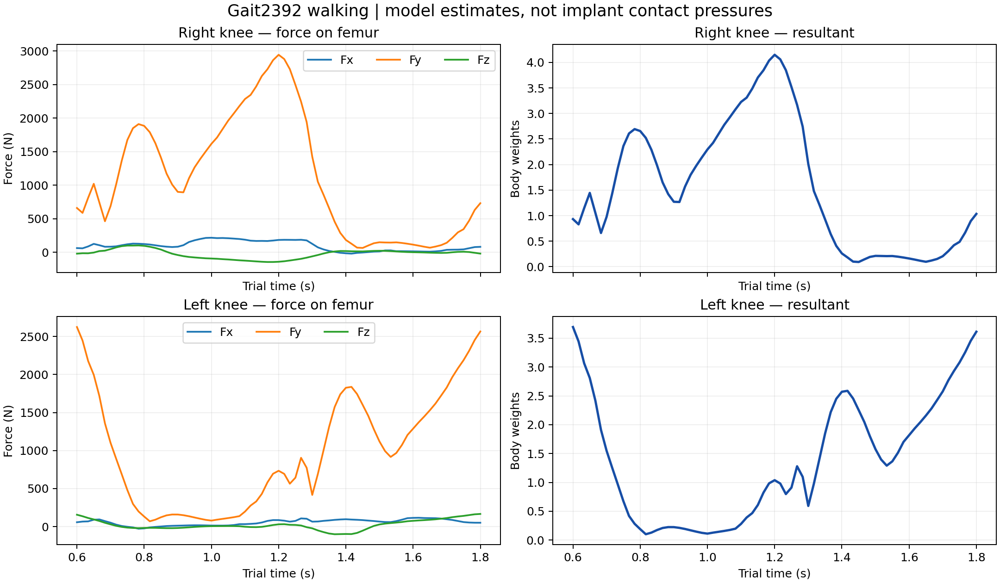
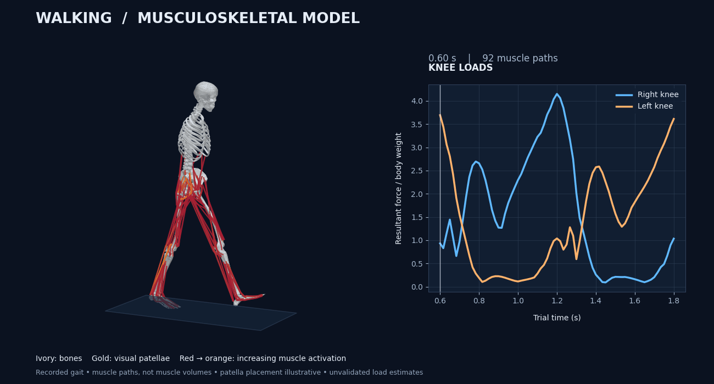

# KneeModelTKA — walking and knee reaction forces

Python/OpenSim simulation of a skeletal walking model with muscle-force estimation and bilateral knee reaction plots. The first implementation uses the open Gait2392 **native-knee** model and the supplied subject01 walking trial; it does not yet contain a knee implant.




## Run on Windows

Install **64-bit Python 3.12**, clone this repository (or check out the implementation branch in GitHub Desktop), and open PowerShell in its folder:

```powershell
py -3.12 -m venv .venv
.\.venv\Scripts\python.exe -m pip install -r requirements.txt
.\.venv\Scripts\python.exe simulate.py
```

On Linux/macOS, create the environment with `python3.12 -m venv .venv` and use `.venv/bin/python` instead. OpenSim wheel availability varies by platform. This implementation was executed on Linux with OpenSim 4.6 and Python 3.12; Windows wheels exist, but Windows execution has not been tested here.

The first run downloads the model, walking motion, force-plate data and bone meshes from the official OpenSim repository. Every asset is pinned to a commit and checked against its Git blob hash. Later runs use the verified local cache. No OpenSim desktop application, graphics server or ffmpeg is needed.

```powershell
.\.venv\Scripts\python.exe simulate.py --start 0.6 --end 1.8 --fps 20
.\.venv\Scripts\python.exe simulate.py --no-animation
.\.venv\Scripts\python.exe -m unittest discover -s tests -v
```

## What is simulated

1. Load the scaled 72.6 kg Gait2392 model (23 coordinates, 92 muscle actuators).
2. Prescribe the supplied inverse-kinematics walking motion. This is a recorded-motion replay and inverse analysis, **not autonomous forward walking prediction**.
3. Apply the matching measured bilateral ground-reaction forces and centers of pressure.
4. Low-pass filter coordinates at 6 Hz; OpenSim differentiates them for dynamics.
5. Solve static optimization at each sample, minimizing squared activations with muscle physiology and explicit reserve actuators.
6. Pass those actuator forces into JointReaction with the same model, motion, filter and external loads.
7. Report forces **on the parent femur at each knee**, expressed in that femur's local frame. Render the actual bone meshes with the recorded IK motion.

The animation uses the original IK positions; the force analysis uses their 6 Hz filtered version. The default 0.6–1.8 s interval contains walking steps but is not segmented heel-strike to heel-strike. Plot axes therefore show trial seconds, not percent gait cycle. The GIF loops by restarting the recorded interval.

## Outputs

| File in `results/` | Content |
|---|---|
| `walking.gif` | Skeletal walking replay with synchronized force cursor |
| `walking_preview.png` | Still preview |
| `knee_forces.png` | Local Fx/Fy/Fz and resultant/BW for both knees |
| `knee_forces.csv` | Time, signed components in N, resultant in N and body weights |
| `reserve_forces.csv` | Every explicit residual/reserve actuator |
| `summary.json` | Peaks, mass, provenance, checks and quality flags |
| `opensim.log` | Solver diagnostics |
| `*.sto`, `*.xml`, `model.osim` | Raw forces and generated analysis configurations |

Fx, Fy and Fz are model-local components, not automatically clinical anatomical measurements. The femur y-axis runs approximately along the shaft; positive Fy on the femur is approximately compressive. The resultant is `sqrt(Fx²+Fy²+Fz²)`. Body-weight normalization uses model mass and gravity. These are joint-structure reaction estimates; they are not net inverse-dynamics moments, medial/lateral compartment forces, implant surface pressures, or finite-element stresses.

## Demonstration results and limitations

The checked-in example gives peak resultants of approximately **2.95 kN (4.15 BW) right** and **2.63 kN (3.69 BW) left** over the default interval. These are outputs of this generic modeling choice, not validated physiological measurements.

**Quality flags remain:** peak pelvis residual force is about **11.5% BW**, and peak knee reserves are about **2.96 Nm right / 2.56 Nm left**. Review `summary.json` before interpreting any plot. The 5% BW / 2 Nm flags are conservative diagnostic thresholds selected for this demo, not clinical acceptance criteria. Residual reduction, reserve sensitivity analysis, subject-specific scaling and validation against measured loads are needed for research use. No residual reduction or patient-specific calibration is performed here.

Reserve actuators have optimal forces of 100 for pelvis coordinates and 10 for other coordinates (N for translations, Nm for rotations); their controls are unbounded and penalized in static optimization. These choices affect muscle recruitment and knee loads. Static optimization does not identify an individual's co-contraction uniquely. Gait2392 has a simplified knee and lacks explicit implant geometry/contact, so it cannot answer TKA contact-pressure questions without a more detailed model.

## Verification

The program rejects nonfinite tables, nonmonotonic times and solver convergence failures, checks matched SO/JR sample times, verifies equal-and-opposite parent/child reactions in ground, and verifies force magnitude is invariant under frame rotation. Unit tests cover storage parsing/round trips, invalid time rejection, asset hashing and mesh triangulation. Passing these checks demonstrates implementation consistency, not clinical validity.

## Sources and attribution

- [Official OpenSim models repository](https://github.com/opensim-org/opensim-models), pinned commit `d9b05d470b1a481c222372c85b75772faf8f7792`; paths and hashes in `assets.json`.
- [Gait2392 model documentation](https://opensimconfluence.atlassian.net/wiki/spaces/OpenSim/pages/53086215/Gait+2392+and+2354+Models).
- [JointReaction documentation](https://opensimconfluence.atlassian.net/wiki/spaces/OpenSim/pages/53089600).
- See [THIRD_PARTY.md](THIRD_PARTY.md) for model and geometry credits/license notices.
